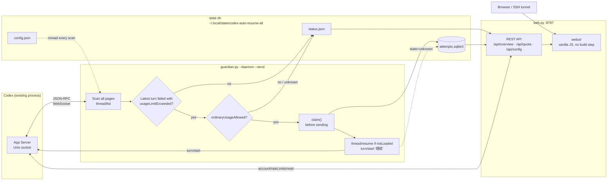

# Codex Auto-Resume Guardian v1 (experimental)

English | [简体中文](README.zh-CN.md)

Automatically resumes the **original** Codex threads that stopped because the account hit
its usage limit, as soon as quota is available again.

It works against an existing Codex CLI `0.161.0` App Server
(`~/.codex/app-server-control/app-server-control.sock`). It never starts a second App
Server and never forks or re-keys a thread: the continuation is sent to the same thread ID.

- **Every scan walks all `thread/list` pages**, so quota failures that happened before the
  first boot are picked up too.
- Only threads whose **latest turn is `failed`** with
  `error.codexErrorInfo == 'usageLimitExceeded'` are considered.
- Sending requires `ordinaryUsageAllowed is True`; any other value waits. When quota is
  back, every eligible thread is resumed by default — there is no per-thread cap.
- SQLite deduplicates by `(thread ID, failed turn ID)`. The claim row is written **before**
  `turn/start`; ambiguous results are recorded as `unknown` and never re-sent. A later,
  different failed turn counts as a new recovery event.
- Thread status and latest turn are re-checked right before sending, so a manual resume is
  not duplicated.
- `notLoaded` threads are loaded with `thread/resume`; no fork, no new thread ID.
- **Dry-run by default** — only `--send` actually writes. Ships with systemd user units
  (Linux) / launchd LaunchAgents (macOS) and a local web console (`web.py`) for metrics,
  live quota and a project allow-list.

No third-party dependencies: runtime and web console are pure Python standard library.

## Architecture



Runtime pieces:

| Component | Role |
| --- | --- |
| `guardian.py` | Scans threads, checks quota, claims and sends the continuation; writes `status.json` |
| `probe_transport.py` | Hand-written WebSocket + JSON-RPC client over the Unix socket (RFC 6455 framing, 64 MiB frame cap, linear reassembly) |
| `web.py` | Stdlib HTTP server: read-only APIs, live quota probe with cache, project allow-list config |
| `webui/` | Static frontend (`index.html` / `app.js` / `style.css`), served as-is |
| `install.sh`, `install_macos.py` | Install to a fixed directory and (re)start systemd units / launchd agents |
| `attempts.sqlite3` | At-most-once ledger (`claimed_at`, `state`, thread/title/cwd/project snapshot) |
| `status.json` | Last scan snapshot, atomically rewritten each round |
| `config.json` | Project allow-list, written by the web console and re-read every scan |

Scan flow per round: read `config.json` → walk all thread pages → keep `usageLimitExceeded`
failures not seen before → read `account/rateLimits/read` → claim each candidate in SQLite
→ `thread/resume` if needed → `turn/start` with `继续` → record `submitted` / `unknown`.

## Install

The repository can live anywhere. `install.sh` copies the scripts into the fixed directory
`~/.local/share/codex-auto-resume/`; service definitions only reference that directory, so
moving or renaming the checkout does not require editing units.

`install.sh` detects the platform: systemd user units on Linux, launchd LaunchAgents on macOS.

Optional manual check first:

```bash
python3 -m py_compile guardian.py probe_transport.py web.py install_macos.py
python3 guardian.py         # first read-only scan, including historical failures
python3 guardian.py --status
python3 guardian.py --send  # WARNING: really sends "继续" to every eligible original thread
```

Install as a resident service once you are happy:

```bash
./install.sh
# Linux
journalctl --user -u codex-auto-resume-all.service -f
# macOS
tail -f ~/Library/Logs/codex-auto-resume/guardian.log
```

`install.sh` copies the scripts, `webui/` and the platform service definitions, then
enables and restarts the services. After changing code, run `./install.sh` again — the
services run the installed copy, not the checkout.

- Install dir: `~/.local/share/codex-auto-resume/` (override with `CODEX_GUARDIAN_INSTALL_DIR`)
- State DB: `~/.local/state/codex-auto-resume-all/attempts.sqlite3` (independent of the repo/install dir)
- Config: `~/.local/state/codex-auto-resume-all/config.json` (written by the web console)

### macOS (launchd)

On Darwin, `install.sh` calls `install_macos.py`, which generates and loads two LaunchAgents:

| Label | Command | Log |
| --- | --- | --- |
| `com.codex-auto-resume.guardian` | `guardian.py --daemon --interval 120 --send` | `~/Library/Logs/codex-auto-resume/guardian.log` |
| `com.codex-auto-resume.web` | `web.py --host 127.0.0.1 --port 8787` | `~/Library/Logs/codex-auto-resume/web.log` |

```bash
ls ~/Library/LaunchAgents/com.codex-auto-resume.*.plist
launchctl print gui/$(id -u)/com.codex-auto-resume.guardian | head -20
launchctl kickstart -k gui/$(id -u)/com.codex-auto-resume.guardian   # restart guardian
launchctl kickstart -k gui/$(id -u)/com.codex-auto-resume.web        # restart console
```

- launchd **does not expand `~` and does not inherit the login shell's `PATH`**, so the
  plists contain absolute paths. The interpreter defaults to the `python3` found on `PATH`
  when `install.sh` runs (Homebrew's stable symlink, not a versioned Cellar path); override
  with `CODEX_GUARDIAN_PYTHON=/path/to/python3 ./install.sh`.
- If you use a custom `CODEX_HOME`, it is written into the plist `EnvironmentVariables` so
  the guardian connects to the same App Server socket.
- Write plists without loading (troubleshooting): `python3 install_macos.py --install-dir ~/.local/share/codex-auto-resume --no-load`.
- A graphical login session is required (LaunchAgents belong to `gui/<uid>`); over plain
  SSH without a login session, `launchctl` may report that the domain does not exist.
- Uninstall:

  ```bash
  launchctl bootout gui/$(id -u)/com.codex-auto-resume.guardian
  launchctl bootout gui/$(id -u)/com.codex-auto-resume.web
  rm -f ~/Library/LaunchAgents/com.codex-auto-resume.*.plist
  rm -rf ~/.local/share/codex-auto-resume
  # state dir ~/.local/state/codex-auto-resume-all is kept by default
  ```

## Web console

`install.sh` also installs `codex-auto-resume-web.service` (Linux) /
`com.codex-auto-resume.web` (macOS). It listens on `127.0.0.1:8787` only:

```bash
# Linux
systemctl --user status codex-auto-resume-web.service
journalctl --user -u codex-auto-resume-web.service -f
# macOS
launchctl print gui/$(id -u)/com.codex-auto-resume.web | head -20
tail -f ~/Library/Logs/codex-auto-resume/web.log
# tunnel from your laptop, then open http://127.0.0.1:8787/
ssh -L 8787:127.0.0.1:8787 huangrenhe@<server>
```

The page shows:

- daemon status, SEND / DRY-RUN mode, last scan time and interval
- quota: **remaining** percentage and reset time for the 5-hour / weekly windows (same
  framing as Codex `/status`), plus the quota state; live probe cached for 10s by default
- scan metrics: threads, candidates, unmonitored, duplicates, errors, round duration
- candidate and unmonitored details (thread, cwd, failed turn)
- submission history (`attempts` table, including `unknown`)
- **project allow-list** (⚙ menu, top right): add/remove/enable/disable. The guardian
  re-reads it every scan, so no restart is needed

Matching rule: **empty list (or all disabled) = monitor every thread**; otherwise only
threads whose `cwd` equals a project path or lives below it are resumed.

Local debugging: `python3 web.py --state-dir ~/.local/state/codex-auto-resume-all --no-live`.

Read-only APIs: `/api/overview`, `/api/config`, `/api/attempts`, `/api/quota`; config
updates use `PUT /api/config` (requires `Content-Type: application/json`).

To keep it running after logging out of SSH: Linux admins can run
`sudo loginctl enable-linger huangrenhe`; macOS LaunchAgents belong to `gui/<uid>` and need
a logged-in graphical session (automatic login works).

## Safety constraints

1. `--send` performs real requests: it can modify code, consume quota and run tests. Always
   validate in a scratch repository with dry-run first.
2. Original threads may contain operations that need human approval or touch production. The
   guardian never approves anything; resumed Codex still runs under the existing sandbox and
   approval policy, so keep permissions minimal.
3. Resuming everything by default means multiple sessions may edit **the same repository
   directory** concurrently and conflict. Use separate Git worktrees for parallel tasks. This
   version does not create worktrees and does not limit concurrency per directory.
4. HTTP/WebSocket/JSON-RPC cannot guarantee exactly-once delivery. The guardian provides
   **at most one automatic attempt** and never re-sends an ambiguous request. `unknown`
   entries need manual review.
5. Persistence after the Mac goes offline depends on the existing App Server's lifetime. If
   the socket disappears, the guardian logs the error and reconnects next cycle; it never
   restarts or replaces the App Server on its own.
6. If a Codex upgrade changes `thread/turns/list` pagination semantics, the guardian may miss
   or misjudge threads. Validate on a small scale before using it on important projects.
7. The web console binds `127.0.0.1` and has **no authentication**. Anyone who can reach it
   can edit the allow-list, so do not bind `0.0.0.0` or expose it publicly. Prefer SSH
   port forwarding.
8. macOS Unix socket paths are limited to 104 bytes (Linux: 108). A deep `CODEX_HOME` makes
   `app-server-control.sock` too long; `probe_transport.py` reports an error instead of
   truncating the path. Point `CODEX_HOME` at a shorter directory.

## Tests

```bash
python3 -m unittest test_guardian test_web test_transport test_macos -v
```

All tests are offline: `test_guardian.py` uses a `FakeServer`, `test_web.py` starts a real
HTTP server on `127.0.0.1:0` with a temporary state dir (live probe disabled),
`test_transport.py` uses a fake socket, and `test_macos.py` only inspects generated plists
without calling `launchctl`.

## License

[MIT](LICENSE)
